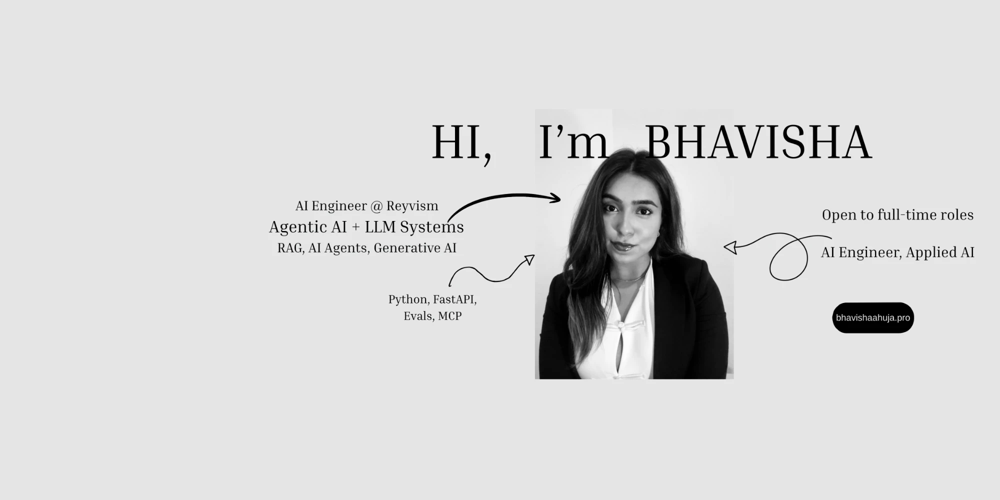

# Hi, I'm Bhavisha 👋

**AI/ML Engineer · Data Science (CS) @ UIC '26 · I build AI agents that act in the real world, and the guardrails that keep them honest**

My recent work is about one question: **what has to be true before an AI agent is allowed to spend money, press a button, or report a result?** I've built agents that pay with PayPal, press physical buttons with servo fingers, and buy parts for factories. Each one follows the same rule: **the model proposes, the code decides.** The LLM handles language and judgment. Fixed, tested code owns the prices, the policy, and anything that touches money or hardware. A human is pulled in only when something actually looks off.

I'm looking for full-time roles in **AI Engineering** or as a **Forward Deployed Engineer (FDE)**, and I'm available now.

🌐 [bhavishaahuja.pro](https://www.bhavishaahuja.pro/) · 💼 [LinkedIn](https://www.linkedin.com/in/bhavisha-ahuja180503/) · ✉️ [Email](mailto:bhavishaahuja800@gmail.com)

---

## 🚀 Featured Projects

### [Checkout Anything](https://github.com/Bhavishaahuja/CheckoutAnything) · PayPal AI Hackathon · [Live demo](https://checkout-anything.onrender.com)
Opens any online store to AI shopping agents, and makes sure every agent order is one the human actually meant. Three parts:

- **Connect:** paste a store URL and Claude writes a declarative `store_spec`. Fixed Python then verifies every item twice, once against the page text and once by creating a real PayPal sandbox order and reading it back. Claude repairs any mismatch, with 3 tries at most. Claude never writes code and never calls PayPal
- **Check** (started as its own repo, [Leash](https://github.com/Bhavishaahuja/leash)): the agent's payment is authorized but held. Fixed rules, then Claude, compare the order with the human's original request. A clean match is captured automatically, and anything off goes to a one-screen approve/void page. A "rubber-stamp watch" times approvals and asks more pointedly when the human stops really reading them
- **Defend:** when a buyer disputes an order, the merchant's records become an evidence packet that is filed through PayPal's Disputes API
- **Evals, scored against hand-written ground truth:** Connect got 39 of 39 prices right across 21 runs, verified **0** wrong prices, and held up against a prompt-injection trap page. Check caught **35 of 35** bad orders with **0** wrong auto-captures, compared with 7 of 35 for rules alone
- Security built in: an SSRF-guarded fetcher, single-use hashed review links, agent identity taken from API keys, idempotent capture and void, and a fail-closed design

**Stack:** Python · FastAPI · Claude API · PayPal Orders v2, Vault & Disputes APIs · PostgreSQL · React · AG Grid · Render

### [Physical MCP](https://github.com/PamAntonio/physical-mcp) · Meta Global AI Developer Hackathon · [physicalmcp.dev](https://physicalmcp.dev)
An API for machines that don't have one. A webcam watches a device's panel, servo fingers press its buttons, and an AI runs it through MCP tools, with a human approval gate in front of anything risky. Built with [@PamAntonio](https://github.com/PamAntonio), who built the hardware rig and firmware.

- **My part:** the MCP server, the backend step runner, vision, the risk scorer, the planner hookup and plan check, the web app, calibration, the live camera, and the dashboard metrics
- The AI can only call five tools (`get_controls`, `press`, `read_screen`, `get_frame`, `stop`), and every safety rule lives in the backend: a press budget per job, hold-time limits, and press-and-hold approval for anything that turns on an output or wipes data
- Screen reads use voting: two reads must agree, and a low-confidence read pauses the job instead of guessing. After every press the camera reads the screen again to confirm it worked
- The risk scorer can only add caution. If it fails, the step defaults to high risk, never low
- Used SAM 3.1 on a real rig frame to locate the device's buttons and screen

**Stack:** Python · FastAPI · MCP · Muse Spark · SAM 3.1 · Next.js · ESP32

### [Crosscheck](https://github.com/Bhavishaahuja/crosscheck)
Catches agent runs that finish green but give the wrong answer. If a tool returns 10 and the agent says 12, nothing normally flags it. Crosscheck reads a finished [Sim](https://sim.ai) run and checks every claim in the final answer against that run's own tool outputs.

- Plain code checks first: numbers, dates, statuses and names, including derived values like sums, averages and counts across tool calls. Claude is called only for claims code can't settle, with forced tool use and a strict schema
- Flagged runs alert Slack or a webhook, just like a failed run would
- Code alone caught 9 of 10 planted mismatches with 0 false alarms. It settled 98% of claims without calling an LLM, adding about 3 ms and $0 per run

**Stack:** Python · Claude API · Sim Logs API

### [Cartkeeper](https://github.com/Bhavishaahuja/Cartkeeper) · in progress
Agentic purchasing for small manufacturers with no procurement team. A technician types *"Loom L-07 heald wires snapped, need 500 today"*. The agent checks the storeroom, quotes suppliers in parallel, picks the most reliable one, applies the owner's rules, and gets the right approval.

- Uses LangGraph only where it earns its place: `Send` fan-out for parallel quotes, a bounded re-plan loop, and `interrupt()` with a Postgres checkpointer, so an approval can wait for hours and survive a restart
- A policy gate in plain Python re-reads prices, suppliers and budgets from source and never trusts the model's proposal. The agent has no tool that approves its own purchase
- Scores supplier reliability from the company's own order history, shrunk toward the pooled average so a supplier with 2 lucky orders can't outrank one with 200 solid ones
- Industry rules live in config files ("packs"), not code. The first pack is a textile mill. 76 tests
- **Status:** the agent graph runs end to end with stubbed payments. Stripe Issuing cards and the web UI are next

**Stack:** LangGraph · Claude API · FastAPI · PostgreSQL · pytest

### [PrepPilot](https://github.com/Bhavishaahuja/preppilot) · [preppilot.site](https://www.preppilot.site)
Meeting prep on autopilot. Give it a name and a company, and in about 20 seconds you get a cited briefing: a snapshot of the person, talking points, sharp questions, and how you can help each other.

- A custom agentic pipeline (plan → parallel research → identity check → brief) built without a framework, using forced tool calls with the Claude API for reliable structured output at every step
- An identity check removes same-name strangers before anything gets written, and every claim links to a source
- Six research angles run in parallel on the live web, which cut briefing time from ~90s to ~20s
- Shipped as a real product: Supabase magic-link auth, saved history behind row-level security, email through Resend, Docker, and Kubernetes manifests for self-hosting

**Stack:** Python · FastAPI · Claude API · Tavily · React · Vite · Tailwind CSS · Supabase · Docker · Kubernetes · Render · Vercel

### [DeCode](https://github.com/Bhavishaahuja/DeCode) · AEC Tech Hackathon 2026
A multi-agent system that reverse-engineers ancient megaprojects (Giza, Uruk, Mohenjo-daro, the Qin walls) the way a contractor would. Built in 26 hours at Gensler Chicago, where I did about 80% of the build on a 5-person team.

- A 7-stage agent pipeline (router → archaeologist → engineer → estimator → builder → critic → presenter), with a critic that checks every answer before the user sees it
- An evidence layer extracts, dedupes and validates construction claims from archaeological sources, so every conclusion is cited
- The math stays out of the LLM: labor, time, haul force and carbon come from deterministic engineering tools. A rule-based fallback runs the whole pipeline without an API key

**Stack:** Python · FastAPI · Claude API

---

## 🧩 More Projects

- **[CreatorOS](https://github.com/Bhavishaahuja/CreatorOS) · [Live demo](https://creator-os-seven-topaz.vercel.app):** content planning for Instagram creators that fits around their real Google Calendar. Shaped by user research with creators. It has a pgvector RAG layer that learns from approved and rejected ideas, a versioned prompt changelog, and an automated output eval. `Next.js` `Claude API` `Supabase` `pgvector`
- **[CartLens](https://github.com/Bhavishaahuja/CartLens):** customer analytics on ~100K Olist orders: Python ETL → BigQuery → Power BI and Tableau. It found that late deliveries drop reviews from 4.29 to 2.27 stars, and I caught an average-of-ratios bias that overstated retention ~10x. Its supplier-scoring ideas now power Cartkeeper. `BigQuery` `SQL` `Power BI` `Tableau`
- **[The Approval Trap](https://github.com/Bhavishaahuja/AgentLoop):** a live demo for my talk *"Keep a Human in the Loop."* One agent runs the same script under two oversight modes. Approving every action lets a bad step slip through, while flagging only the unusual action catches it. `TypeScript` `React`
- **[Resume Optimizer](https://github.com/Bhavishaahuja/Resume_optimisation):** a portable `SKILL.md` skill for ChatGPT, Claude and Codex. It runs a recruiter audit, an XYZ-formula rewrite and an ATS skim test, and never invents experience or numbers. `Prompt engineering` `Agent skills`

## 🧪 ML & Data Science

- **[Cell Type Classification (scRNA-seq)](https://github.com/Bhavishaahuja/cell-type-classification-scrnaseq):** a Random Forest that identifies 8 cell types from 20,000 single-cell samples across ~3,000 genes. It handles heavy class imbalance and raised accuracy from 98.5% to 99.1%. `Python` `scikit-learn`
- **[Urban Economic Opportunity Analysis](https://github.com/Bhavishaahuja/Urban-Economic-Opportunity-Analysis):** socioeconomic gaps across 4,406 census tracts in 4 cities, using the U.S. Census ACS API, with 4 ML models compared for forecasting poverty rates. `Python` `Census API`
- **[Cereals Rating](https://github.com/Bhavishaahuja/Cereals-Rating):** multiple linear regression with backward elimination. Sodium, fiber and sugar explain 92%+ of the variance in ratings. `Python` `Statistics`

---

## 🛠️ Tech I work with

**Languages:** Python · TypeScript · SQL · R
**AI/ML:** Claude API · LangGraph · MCP · agentic pipelines · forced tool use · LLM evals · RAG · pgvector · computer vision · scikit-learn
**Payments:** PayPal Orders, Vault & Disputes APIs · Stripe
**Backend & Data:** FastAPI · PostgreSQL / Supabase · BigQuery · Google Cloud Storage
**Frontend:** React · Next.js · Vite · Tailwind CSS · AG Grid
**Infra:** Docker · Kubernetes · Render · Vercel · AWS
**BI:** Power BI · Tableau

🏅 AWS Certified Cloud Practitioner

---

📫 Open to AI Engineering and Forward Deployed Engineer roles. The easiest way to reach me is [LinkedIn](https://www.linkedin.com/in/bhavisha-ahuja180503/) or [email](mailto:bhavishaahuja800@gmail.com).
